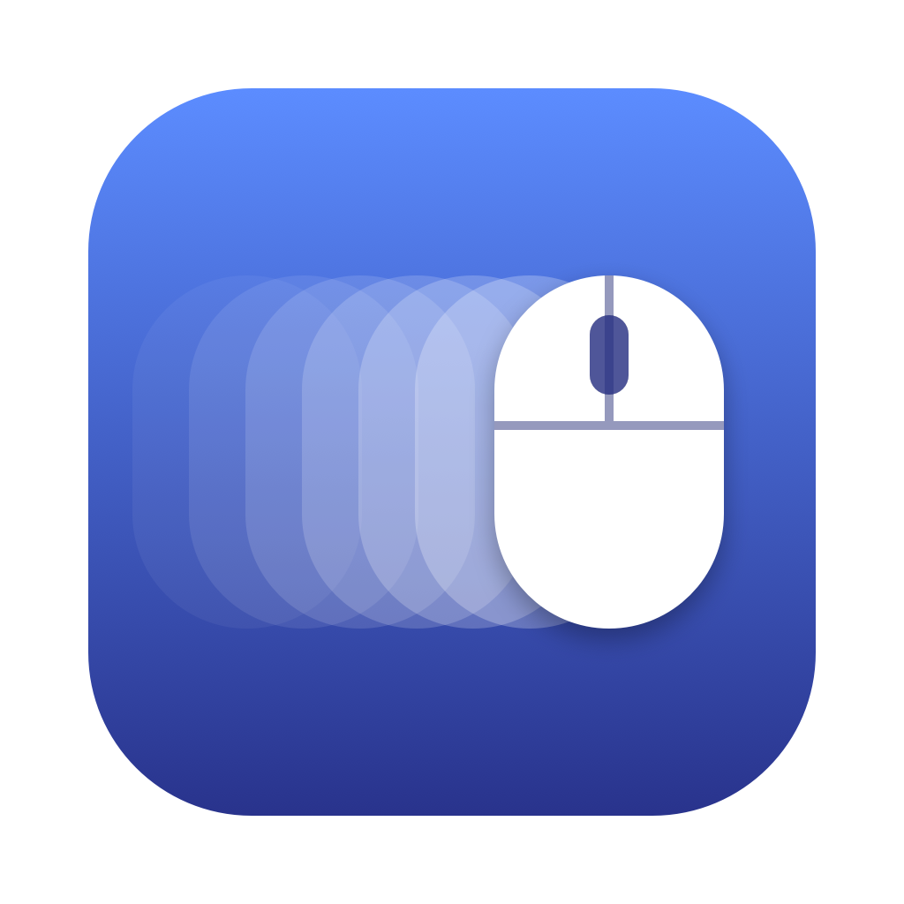

# 커서런



마우스 커서가 움직인 거리를 재서 맥 메뉴바에 보여주는 주행거리계.
누적 거리가 "한강 횡단", "에베레스트 등반" 같은 업적 단계를 넘으면 알림이 뜬다.

- 메뉴바: 오늘 이동 거리와 타자 수 (`1.2km · 3,410타`)
- 메뉴: 오늘·누적 거리와 타자 수, 달성한 업적과 다음 목표, 업적 전체 목록, 로그인 시 실행
- 업적은 누적 거리 기준이다. 날이 바뀌어도 초기화되지 않고 계속 이어진다
- 오늘 기록은 자정에 0으로 돌아가고, 그날 기록은 날짜별로 저장된다 (메뉴의 "기록"에 최근 30일치가 "11월 10일  1.23km · 3,410타"처럼 보인다)
- 타자 수는 눌린 횟수만 세고 어떤 키인지는 읽지 않는다. 시스템 설정 → 개인정보 보호 및 보안 →
  입력 모니터링에서 커서런을 허용한 뒤 앱을 다시 켜야 한다. Apple 개발자 인증서가 없는 맥에서는
  임시 서명을 쓰므로, 다시 빌드할 때마다 목록에서 커서런을 지우고 다시 허용해야 한다.
- 화면의 실제 물리 크기 기준으로 미터 환산 (주 디스플레이 기준)
- 서버 없음, 기록은 이 맥에만 저장

## 다운로드

[최신 버전 받기](https://github.com/dgim9390/cursor-run/releases/latest) — `CursorRun-*.dmg`를 내려받는다.

1. DMG를 열고 커서런을 Applications로 끌어다 놓는다.
2. 처음 실행하면 "확인되지 않은 개발자" 경고가 뜬다. Apple 공증을 받지 않은 앱이라 그렇다.
   시스템 설정 → 개인정보 보호 및 보안 → 아래쪽의 **그래도 열기**를 누른다.
3. 타자 수를 세려면 같은 화면의 입력 모니터링에서 커서런을 켜고 앱을 다시 실행한다.

## 빌드

macOS 13 이상과 Xcode 명령줄 도구가 필요하다.

```sh
./build.sh
cp -R 커서런.app ~/Applications/
open ~/Applications/커서런.app
```

## 파일

- `CursorRun.swift` — 앱 전체 (업적 목록은 `milestones`)
- `make-icon.swift` — 아이콘 그리기
- `build.sh` — 앱 번들 만들기

번들 ID와 실행 파일 이름은 `MouseOdometer`다. 바꾸면 저장된 기록과 알림 권한이 초기화된다.
